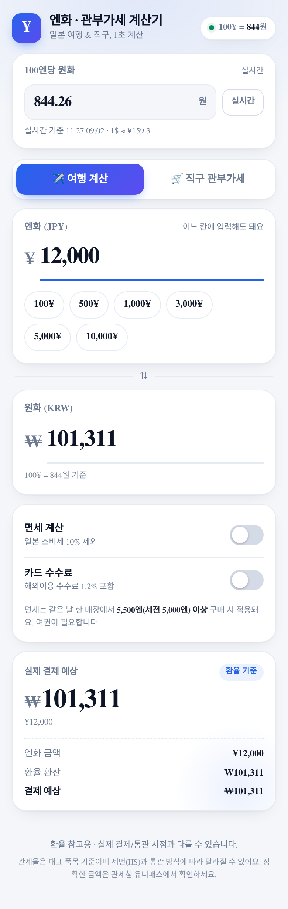

# 💱 일본 직구·여행 엔화 + 관부가세 1초 계산기

실시간 엔화 환율로 **일본 여행 경비**와 **직구 관부가세**를 한 화면에서 계산하는 웹 앱입니다.
설치 없이 브라우저에서 바로 열리고, 아이폰 사파리에서 쓰기 좋게 만들었습니다.

- 🌐 라이브 페이지: **https://nugj12-code.github.io/JPY-calc/**


- 파일 구성: `index.html` (HTML·CSS·JS 한 파일, 외부 빌드 도구 없음) + `og.png` (공유 카드 이미지) + `live-preview.png` (화면 미리보기) + `README.md`

---

## 여는 방법

1. 위 라이브 주소를 아이폰 사파리에서 연다.
2. 공유 버튼 → **홈 화면에 추가**를 누르면 앱처럼 전체 화면으로 열린다.
3. 내 컴퓨터에서만 보고 싶으면 `index.html` 파일을 더블클릭해도 된다 (환율만 인터넷 필요).

---

## 무엇을 계산하나

### ✈️ 여행 탭
- **양방향 환전**: 엔화 칸과 원화 칸 어느 쪽에 입력해도 즉시 반대로 환산.
- **빠른 금액 버튼**: 100¥ / 500¥ / 1,000¥ / 3,000¥ / 5,000¥ / 10,000¥.
- **면세 계산**: 일본 소비세 10%를 뺀 실제 지불액 표시.
  (같은 날 한 매장에서 **5,500엔(세전 5,000엔) 이상** 구매 시 면세, 여권 필요)
- **카드 수수료 1.2%**: 해외 결제 수수료까지 포함한 최종 원화 금액.

### 🛒 직구 관부가세 탭
- 상품가(엔), 배송비(엔 또는 원 선택) 입력.
- 품목 프리셋: 의류·잡화 13% / 화장품·식품 8% / 피규어·완구 8% / 전자기기·도서 0% / 직접 입력.
- **$150 목록통관 자동 판정**: 실시간 JPY→USD 환율로 물품가를 달러로 환산해 한도와 비교.
  - $150 이하 → `면세 · 목록통관` 배지, 관세·부가세 0원.
  - $150 초과 → 과세가격 · 관세 · 부가세(10%) · 총 비용을 항목별로 표시.
- 한도 게이지 바: 지금 물품가가 $150까지 얼마나 찼는지 보여줌.

계산식:

```
과세가격 = 상품가(원) + 국제 배송비(원)
관세     = 과세가격 × 관세율
부가세   = (과세가격 + 관세) × 10%
총 비용  = 과세가격 + 관세 + 부가세
```

> 목록통관 $150 한도는 **물품가격** 기준이며 운송비는 포함하지 않습니다.
> 담배·주류·의약품·건강기능식품·향수 등은 금액과 상관없이 목록통관 대상이 아닙니다.
> 관세율은 대표 세번 기준의 근사치이며, 실제 세액은 관세청 유니패스에서 확인하세요.

---

## 환율은 어떻게 가져오나

1. `https://open.er-api.com/v6/latest/JPY` (무료, CORS 허용) — 1차.
2. 실패하면 `https://api.frankfurter.app/latest?from=JPY&to=KRW,USD` — 2차.
3. 둘 다 실패하면 내장 참고값(100엔 = 844원, 1$ ≈ 160엔)으로 계산하고 화면에 알려줌.

상단 **100엔당 원화** 칸은 직접 고칠 수 있습니다. 카드사·환전소 고시 환율이 다르면 그 값을 넣으면
여행 탭과 직구 탭이 모두 그 환율로 다시 계산됩니다. `실시간` 버튼을 누르면 받아온 환율로 돌아갑니다.

---

## 수익화 붙이는 곳

### Google AdSense
1. `index.html`에서 `📢 수익화 슬롯` 주석을 찾습니다. 두 군데 있습니다.
   - 여행 탭 결과 카드 아래 (`id="ad-slot-travel"`)
   - 직구 탭 결과 카드 아래 (`id="ad-slot-duty"`)
2. AdSense에서 발급받은 광고 단위 코드를 그 `<div>` 안에 붙여넣습니다.
3. `<head>` 안에 AdSense 사이트 스크립트(`<script async src="https://pagead2.googlesyndication.com/pagead/js/adsbygoogle.js?client=ca-pub-...">`)를 넣습니다.
4. AdSense는 사이트 소유 확인이 필요하므로 `nugj12-code.github.io` 도메인을 등록합니다.
5. 커밋 후 푸시하면 1~2분 안에 Pages에 반영됩니다.

### 후원 링크 (Ko-fi / 커피 한 잔)
푸터(`<footer class="foot">`)에 아래처럼 한 줄만 추가하면 됩니다.

```html
<p><a href="https://ko-fi.com/내아이디" target="_blank" rel="noopener">☕ 커피 한 잔 후원하기</a></p>
```

---

## 배포 상태

- 저장소: `nugj12-code/JPY-calc` (public)
- 브랜치: `main` / 루트(`/`)를 GitHub Pages 소스로 사용
- 배포 후 푸시만 하면 자동 반영 (별도 빌드 없음)
